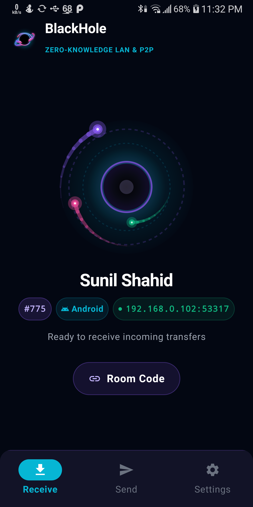
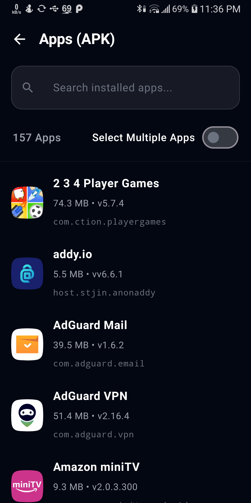
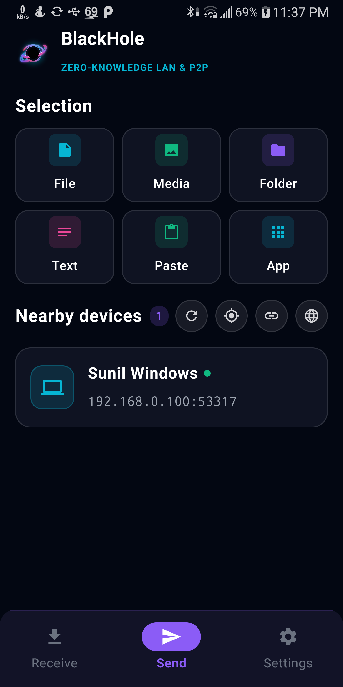

<p align="center">
  
</p>

<h1 align="center">BlackHole for Android</h1>

<p align="center">
  <b>Ultra-Fast, Zero-Knowledge Native Peer-to-Peer File & Clipboard Sharing</b><br>
  <i>Share files, folders, media, apps, and text across your local network at wire speed — 100% offline, air-gapped, and secure.</i>
</p>

<p align="center">
  
  
  
  
  
</p>

---

## 🌌 Overview

**BlackHole for Android** is a modern, high-performance peer-to-peer file transfer engine engineered for maximum throughput and uncompromising privacy. Built entirely in native Kotlin with Jetpack Compose Material 3, BlackHole allows you to beam gigabytes of files, installed apps, full-resolution photos, 4K videos, and clipboard text between your phone, PC, and local peers in seconds without ever touching the Internet.

---

## 🌌 The BlackHole Ecosystem

BlackHole provides a complete 3-system cross-platform ecosystem designed for wire-speed, zero-knowledge transfers:

| Platform | Type | Tech Stack | Highlights | Repository & Downloads |
| :--- | :--- | :--- | :--- | :--- |
| **🌐 BlackHole Web** | Browser-to-Browser Web App | React 19, TypeScript, WebRTC, Vite, Tailwind CSS v4, WebSocket | Zero-install, 6-digit room codes, QR pairing, Web Crypto AES-256-GCM, LAN ICE racing | [📁 **GitHub Repository**](https://github.com/sunilshahid/BlackHole) |
| **📱 BlackHole for Android** | Native Android Application | Kotlin 2.0, Jetpack Compose Material 3, Coroutines | Air-gapped wire-speed TCP streaming, UDP multicast discovery (`224.0.0.167:53317`), in-memory clipboard copy, APK sharing, Foreground Service | [📁 **GitHub Repository**](https://github.com/sunilshahid/BlackHole-Andriod)<br>[⬇️ **Download v1.0.0 APK**](https://github.com/sunilshahid/BlackHole-Andriod/releases/tag/v1.0.0) |
| **💻 BlackHole for Windows** | Native Windows Desktop Client | Pure C++20 (MSVC), Win32 API, Microsoft Edge WebView2 | Near-zero CPU overhead, multi-homed UDP discovery, clipboard image auto-detection (`CF_DIBV5`, `PNG`), Inno Setup Installer & Portable ZIP | [📁 **GitHub Repository**](https://github.com/sunilshahid/BlackHole-Windows)<br>[⬇️ **Download v1.0.0 Installer & ZIP**](https://github.com/sunilshahid/BlackHole-Windows/releases/tag/v1.0.0) |

---

## ⚡ Key Features

* **🚀 Wire-Speed Direct Streaming:** Uses raw TCP socket pipelines and buffered multi-megabyte streams to saturate your local Wi-Fi or mobile hotspot bandwidth (50–100+ MB/s on 5GHz Wi-Fi).
* **🔒 100% Offline & Zero-Knowledge:** Zero accounts, zero login, zero cloud servers, zero trackers, and zero external relay nodes. Your data stays strictly inside your local network.
* **📡 Universal Zero-Config Peer Discovery:**
  * Multi-interface UDP broadcast & multicast on group `224.0.0.167:53317`.
  * Automatic network discovery across mobile hotspots (AP mode) and complex Wi-Fi subnets.
  * Real-time radar radar scanner UI displaying peer aliases, device types, and network status.
* **📋 In-Memory Instant Text & Clipboard Sync:** Send snippets, URLs, phone numbers, or passwords directly to another device's clipboard without creating temporary files on storage.
* **📱 Integrated App (APK) Sharing:** Built-in application picker allowing you to extract and beam installed apps (APKs) directly to other devices without third-party extractors.
* **🛡️ Background Transfer Resiliency:** Powered by an Android Foreground Service with live notification progress, transfer speed (MB/s), and ETA countdown.
* **⭐ Favorites & Quick Save:** Save trusted computers and phones to bypass manual confirmation prompts for seamless workflow integration.
* **💻 Cross-Platform Ecosystem:** Interoperates natively with [BlackHole for Windows](../BlackHole-Windows) and open network peers across your LAN.
* **🎨 Space-Grade Cyber Dark UI:** Fully immersive dark theme, responsive layout, smooth Jetpack Compose animations, and edge-to-edge display support.

---

## 📸 Screenshots

<p align="center">
  
  
  
  
</p>

---

## 🏗️ Architecture & Tech Stack

```text
BlackHole-Android/
├── app/
│   ├── src/main/java/com/blackhole/app/
│   │   ├── MainActivity.kt          # Compose UI root, navigation & state coordination
│   │   ├── model/                   # Data models (PeerDevice, FileItem, TransferState)
│   │   ├── network/
│   │   │   ├── DiscoveryEngine.kt   # Dual-mode UDP multicast/broadcast peer scanner
│   │   │   ├── TcpClientSender.kt   # High-speed chunked socket transfer engine
│   │   │   ├── LocalHttpServer.kt   # Embedded non-blocking HTTP transfer handler
│   │   │   └── TlsHelper.kt         # Ephemeral self-signed TLS certificate management
│   │   ├── service/
│   │   │   └── TransferService.kt   # Android Foreground Service for background transfers
│   │   └── ui/                      # Jetpack Compose screens, dialogs, radar components
│   └── build.gradle.kts             # Gradle build and release configuration
└── build_release.bat                # 1-Click release build script
```

* **Language:** Kotlin 2.0+ (Coroutines, Flow, StateFlow)
* **UI Framework:** AndroidX Jetpack Compose with Material 3
* **Networking:** Java NIO / Standard Sockets (`DatagramSocket`, `MulticastSocket`, `Socket`), OkHttp 4
* **Security:** Java Cryptography Architecture (JCA / JSSE) with ephemeral self-signed X.509 certificates
* **Minimum Android Version:** Android 9.0 (API Level 28)
* **Target Android Version:** Android 15 (API Level 35)

---

## 🛠️ Building & Packaging

### Prerequisites
* **Java Development Kit (JDK):** JDK 17 or higher
* **Android SDK:** Platform SDK 35, Build Tools 34.0.0+

### Option A: 1-Click Release Script (Windows)
Run the automated build script in Command Prompt or PowerShell:
```cmd
build_release.bat
```

### Option B: Command Line (Gradle)
```bash
# On Windows
gradlew.bat assembleRelease

# On Linux / macOS
./gradlew assembleRelease
```

The resulting signed release APK will be located at:
```text
app/build/outputs/apk/release/app-release.apk
```

> [!NOTE]
> Release APKs and installer binaries are published directly to the project's **GitHub Releases** page. Build outputs are excluded from source version control to maintain a lightweight repository.

---

## 🔐 Permissions Overview

BlackHole requests only the minimal permissions required for air-gapped local networking:

| Permission | Purpose |
| :--- | :--- |
| `NEARBY_WIFI_DEVICES` | Discover and connect to nearby peers on Android 13+ without location access |
| `ACCESS_WIFI_STATE` & `CHANGE_WIFI_MULTICAST_STATE` | Send and receive UDP multicast discovery beacons across local Wi-Fi / Hotspot |
| `FOREGROUND_SERVICE` & `FOREGROUND_SERVICE_DATA_SYNC` | Maintain active file streams when the user switches to other apps |
| `POST_NOTIFICATIONS` | Display transfer progress, transfer speeds, and completion status |
| `READ_MEDIA_*` / `READ_EXTERNAL_STORAGE` | Access user-selected media and documents for transmission |

---

## 📄 License

This project is licensed under the [MIT License](LICENSE).
